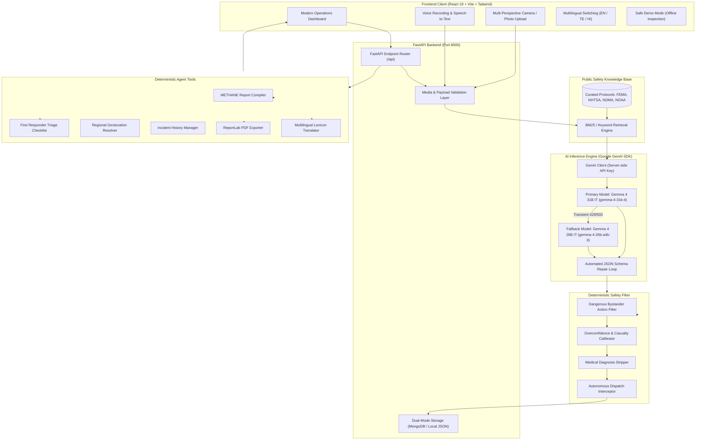

# ResQ Vision — Multimodal Emergency Situation Intelligence

> "See the situation. Understand the risk. Communicate the response."

[](https://opensource.org/licenses/Apache-2.0)
[-red.svg)](https://ai.google.dev/)
[](https://www.digitalocean.com/products/genai-platform)
[](https://fastapi.tiangolo.com/)
[](https://vite.dev/)
[](tests/)

---

### Hackathon Submission Details
- **Submission Category:** **Best Open-Source AI Project**
- **Eligible Model Track:** Best Use of Gemma 4 (`gemma-4-31b-it` / `gemma-4-26b-a4b-it`)
- **Open-Source Licensing:** Application code is fully open-source under the [Apache 2.0 License](LICENSE). Underlying Gemma 4 model weights are provided under the open-weights [Gemma Terms of Use](https://ai.google.dev/gemma/terms).

---

## 1. Problem Statement

In the critical opening minutes of an emergency (traffic collisions, structure fires, flash floods, collapsed buildings), public safety answering points (PSAPs) receive fragmented, panicked bystander calls and chaotic mobile photos. Dispatchers face high cognitive overload:
- Unverified hearsay leads to incorrect emergency response packages.
- Vital hazard indicators (fuel sheen, high-voltage downed cables, hazardous material placards) are easily missed in photographic backgrounds.
- Unconstrained conversational AI models frequently hallucinate certainty, direct untrained citizens into hazardous environments, or invent medical diagnoses.

---

## 2. Solution: ResQ Vision

**ResQ Vision** is a multimodal emergency situation intelligence platform powered genuinely by **Gemma 4** (`gemma-4-31b-it` / `gemma-4-26b-a4b-it`).

The system ingests:
1. **Scene Photography:** 1 to 4 multi-angle perspectives with client and server format/size validation.
2. **User Voice Recordings:** Native browser recording with real-time Speech-to-Text transcription.
3. **Bystander Text Descriptions:** Contextual observations and incident claims.
4. **Geographic Coordinates & Location Context:** Nearest emergency service commands and jurisdictional awareness.

It subjects this multimodal data to unified reasoning, cross-references verified public safety protocols (FEMA, NHTSA, NOAA, NDMA) through a transparent local RAG layer, validates assertions through a deterministic safety shield, and triggers an agentic tool workflow to compile standardized **METHANE** incident reports and first-responder triage checklists.

> **Operational Safety Mandate:** ResQ Vision is strictly a human-in-the-loop operational decision support platform. It never replaces certified emergency services, dispatchers, physicians, or firefighters, and never autonomously deploys responders or contacts authorities.

---

## 3. Architecture & System Design



---

## 4. Why Gemma 4 is Central

- **Encoder-Free Multimodal Reasoning:** Concurrently processes multiple photographic viewpoints alongside witness transcripts and regional geographical data.
- **Strict Structured JSON Schema Adherence:** Emits strictly validated Pydantic structures containing `incident_type`, `incident_summary`, `observed_evidence`, `potential_hazards`, `severity_estimate`, `confidence_or_uncertainty`, `recommended_actions`, and `limitations`.
- **Data Provenance Distinctions:** Rigorously categorizes findings into `observed` (visually verified), `user_reported` (witness claims), and `inferred` (situational hypotheses).
- **Epistemic Humility:** Purpose-instructed to never invent casualties, hidden hazards, or medical diagnoses, and to explicitly output `uncertainties` and `missing_information`.
- **Multilingual Support:** Delivers high-fidelity emergency summaries in **Telugu (తెలుగు)** and **Hindi (हिन्दी)** while preserving uncertainty qualifiers.

---

## 5. Key Features

- **Multimodal Situation Intelligence:** Analyzes up to 4 scene perspectives simultaneously.
- **Evidence-Linked Provenance:** Distinct visual badges for Observed, User Reported, and Inferred facts.
- **METHANE Standardized Reporting:** Major Incident, Exact Location, Type, Hazards, Access, Number/Type of Casualties, Emergency Services.
- **First Responder Checklist:** Actionable triage points separated by priority (Critical, High, Medium).
- **Voice Dispatch & SpeechSynthesis:** Native microphone recording and browser SpeechSynthesis read-aloud briefing.
- **Safe Demo Mode:** 4 pre-calculated benchmark demonstration scenarios (Accident, Flood, Fire, Obstruction) that evaluators can inspect immediately without requiring API credentials.
- **Transparent Local RAG:** 6 curated official protocol references cited in every assessment.
- **ReportLab PDF Export:** Compiles publication-quality emergency operational PDF reports.

---

## 6. Project Structure

```
resq-vision/
├── backend/
│   ├── app/
│   │   ├── agent/               # Agentic orchestration & tool calling service
│   │   ├── ai/                  # Gemma 4 service (Google GenAI SDK)
│   │   ├── api/                 # FastAPI REST routes (/health, /api/analyze, etc.)
│   │   ├── core/                # Configuration & pydantic-settings
│   │   ├── rag/                 # Knowledge base retrieval engine
│   │   ├── safety/              # Deterministic safety sanitizer & constraint shield
│   │   ├── schemas/             # Pydantic models (IncidentAnalysisResponse, Report, Checklist)
│   │   ├── services/            # Storage, PDF export, translation, evaluation
│   │   ├── tools/               # 10 deterministic agent incident tools
│   │   └── main.py              # FastAPI application entrypoint
│   └── requirements.txt
├── data/
│   ├── knowledge-base/          # Curated emergency guidelines (FEMA, NHTSA, NDMA, NOAA)
│   └── storage/                 # Local persistence fallback (incidents.json)
├── frontend/
│   ├── public/demo-assets/      # Verified photographic scene assets
│   ├── src/
│   │   ├── components/          # Reusable UI components (Audio, Uploader, Cards, Modals)
│   │   ├── context/             # Multilingual LanguageContext
│   │   ├── pages/               # Landing, Analyze, Incidents, Evaluation, Demo, About
│   │   ├── services/            # Frontend API client
│   │   └── App.jsx              # Main UI component
│   ├── package.json
│   └── vite.config.js
├── tests/                       # Pytest automated test suite (31 passed, 1 live skipped)
│   ├── test_api_endpoints.py
│   ├── test_e2e_complete.py
│   ├── test_evaluation_live.py
│   ├── test_rag.py
│   ├── test_safety.py
│   ├── test_schemas.py
│   └── test_tools.py
├── .env.example                 # Environment configuration template (placeholders only)
├── .gitignore                   # Ignores credentials, local storage, build outputs
├── LICENSE                      # Apache 2.0 Open-Source License
└── README.md
```

---

## 7. Setup & Running Locally (Windows PowerShell)

### Prerequisites
- Python 3.10+ (Tested on Python 3.12)
- Node.js 18+ & npm
- Google Gemini API Key (optional for Safe Demo Mode; required for live Gemma 4 inference from [Google AI Studio](https://aistudio.google.com/))

### Step 1: Clone Repository & Configure Environment
Open Windows PowerShell:
```powershell
cd c:\Users\Shameer\.gemini\antigravity-ide\scratch\resq-vision

# Copy environment template
Copy-Item .env.example .env
```
Edit `.env` with your API credentials if performing live inference:
```env
# AI Provider Selection ("google" or "digitalocean")
AI_PROVIDER=google

# Provider 1: Google GenAI (Gemma 4)
GEMINI_API_KEY=your_gemini_api_key_here
GEMMA_MODEL=gemma-4-31b-it
FALLBACK_MODEL=gemma-4-26b-a4b-it

# Provider 2: DigitalOcean GenAI Serverless Inference (Open-Weight Models)
# Official Endpoint: https://inference.do-ai.run/v1
DO_INFERENCE_ENDPOINT=https://inference.do-ai.run/v1
DO_INFERENCE_TOKEN=your_do_model_access_key_here
DO_MODEL=meta-llama/Meta-Llama-3.2-11B-Vision-Instruct
DO_FALLBACK_MODEL=meta-llama/Llama-3.3-70B-Instruct

APP_ENV=development
HOST=0.0.0.0
PORT=8000
```

### Step 2: Set Up & Run Backend
In PowerShell terminal 1:
```powershell
# Activate virtual environment
.\venv\Scripts\Activate.ps1

# Install backend dependencies
pip install -r backend/requirements.txt

# Run FastAPI backend
python backend/app/main.py
```
Backend API and OpenAPI interactive documentation will be live at:
- **Health Check:** `http://127.0.0.1:8000/health`
- **Interactive Swagger Docs:** `http://127.0.0.1:8000/docs`

### Step 3: Set Up & Run Frontend
In PowerShell terminal 2:
```powershell
cd frontend

# Install Node modules
npm install

# Start Vite development server
npm run dev
```
Open your browser at `http://localhost:5173`.

---

## 8. Running Automated Tests

Run the complete backend test suite:
```powershell
.\venv\Scripts\pytest
```
Expected output:
```
tests\test_api_endpoints.py ....                                         [ 12%]
tests\test_e2e_complete.py s                                             [ 15%]
tests\test_evaluation_live.py .....                                      [ 31%]
tests\test_rag.py ....                                                   [ 43%]
tests\test_safety.py ....                                                [ 56%]
tests\test_schemas.py ...                                                [ 65%]
tests\test_tools.py ...........                                          [100%]

======================= 31 passed, 1 skipped in 40s =======================
```

To run frontend build checks and linting:
```powershell
cd frontend
npm run lint
npm run build
```

---

## 9. AI Model, Licensing, & Third-Party Disclosures

### AI Model Details
- **Primary Model:** `gemma-4-31b-it` (Google Gemma 4 31B Instruction-Tuned)
- **Fallback Model:** `gemma-4-26b-a4b-it` (Google Gemma 4 26B Mixture-of-Experts Instruction-Tuned)
- **Provider & SDK:** Google GenAI via official `google-genai` Python library.
- **Model Licensing:** Gemma 4 models are governed by the [Gemma Terms of Use](https://ai.google.dev/gemma/terms), which permit responsible open-weights research and commercial deployment. Model weights are subject to Google's terms, while this application source code is distributed under Apache 2.0.

### Third-Party Software Licenses
- **FastAPI:** MIT License
- **Pydantic:** MIT License
- **ReportLab:** BSD License
- **React 19 & React-DOM:** MIT License
- **Vite:** MIT License
- **Tailwind CSS:** MIT License
- **Lucide React:** ISC License
- **Recharts:** MIT License

---

## 10. Known Limitations & Future Improvements

1. **Camera Angles & Nighttime Imagery:** Occlusion, poor lighting, or heavy particulate smoke degrade visual evidence extraction.
2. **Connectivity in Disasters:** When terrestrial cellular towers fail, edge inference (running quantized Gemma models locally on responder devices via Ollama / ONNX) is required.
3. **Sensor Modalities:** Future versions could integrate thermal FLIR camera streams and drone orthomosaic imagery.
4. **Computer-Aided Dispatch (CAD) Integration:** Integration with standard NG911 / NENA i3 call-handling interfaces for accredited PSAPs.

---

## 11. Open-Source License

This project is open-source software licensed under the **[Apache License, Version 2.0](LICENSE)**.
